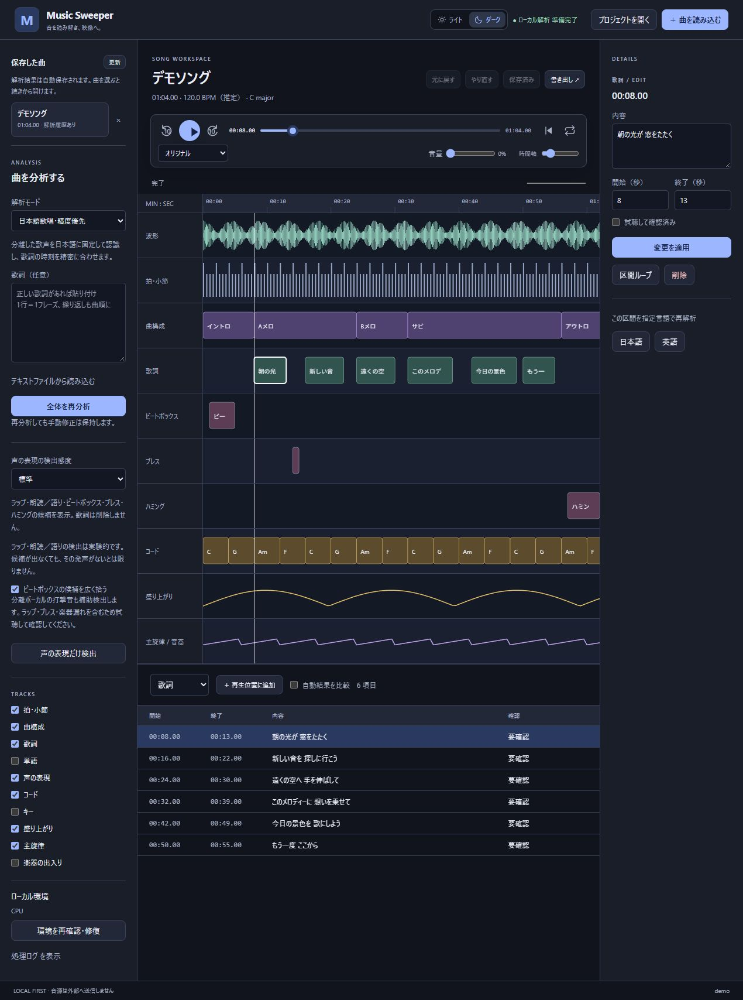

# hodomia

曲の拍、構成、歌詞、コード、音高を同じ時間軸で確認・修正できるローカル音楽解析アプリです。MP3 / MP4 / M4A / WAV / FLACに対応し、1曲15分まで扱えます。MP4は最初の音声トラックを使います。

初回セットアップ後の解析はローカルで実行します。自動推定には誤りや未確定の情報が含まれるため、試聴して確認・修正してください。

## ダウンロード

[最新版のダウンロード（GitHub Releases）](https://github.com/tobyapi/hodomia/releases/latest)から、使うOSのファイルを選んでください。

音源解析はWindows x64版とApple Silicon搭載Mac向けです。Intel MacとLinux x64版は実験的なUIビルドで、音源解析は利用できません。配布形式や署名の状態は[リリース](docs/releases.md)に記載しています。

## 動作環境

| 項目 | 推奨 |
| --- | --- |
| OS | Windows 11 x64、またはApple Silicon搭載Mac |
| GPU | VRAM 8 GB以上のNVIDIA製GPU（Windows） |
| メモリ | 16 GB以上 |
| 空き容量 | 30 GB以上 |

- NVIDIA製GPUがないWindowsとMacでは、CPUで推論します。動きますが、Core i9-9900KFでは分離だけで曲の長さの10倍以上かかりました（別のアプリと並行で測定）。
- 解析環境はPyTorch 2.8（CUDA 12.8）を使います。対応するのはGTX 10シリーズ以降のGPUですが、動作を確かめたのはRTX 2080だけです。Windows 10では確認していません。
- 初回セットアップでPython環境とモデルを取得し、約18 GBを使います。ほかに、解析のたびに曲の長さ1分あたり約85 MBの分離音声をプロジェクトに保存します。
- 3分13秒の曲の解析で、解析プロセスのメモリは最大4.7 GB、GPUメモリは画面表示の分を含めて最大4.8 GBでした。15分の曲ではどちらも増えます。

### 動作確認環境

| 項目 | 内容 |
| --- | --- |
| OS | Windows 11 Home（ビルド26200） |
| CPU | Intel Core i9-9900KF（8コア16スレッド） |
| GPU | NVIDIA GeForce RTX 2080 8 GB（ドライバー610.88） |
| メモリ | 32 GB |
| 解析環境 | Python 3.11、PyTorch 2.8.0+cu128 |

この環境で、3分13秒の曲は解析全体に約7分（435秒、うち分離59秒）かかりました。別のアプリが動いている時間を含みます。歌詞の書き起こしは曲や実行によって時間が変わり、この曲では55〜196秒の幅がありました。15分の曲は約20分の見込みです。分離だけを実測すると167秒でした。

Apple Silicon搭載Macは、GitHub Actionsのmacos-15ランナーで合成音の解析が最後まで通ることだけを確かめています。これは分離モデルを替える前（2026年9月）の確認で、実際の曲での所要時間は測っていません。

## はじめる

セットアップをコーディングエージェントに依頼する場合は、このリポジトリを開いて次のプロンプトを渡してください。初回は依存パッケージとモデルをダウンロードするため、ネット接続と数十GBの空き容量が必要です。

```text
hodomiaをこの環境で使えるようにセットアップし、デスクトップアプリを起動してください。

AGENTS.mdとdocs/development.mdを読み、必要な同梱スキルを使って進めてください。
まず環境を診断し、不足する依存関係と解析モデルを準備してください。
実際のTauriアプリが起動するところまで確認し、残った問題があれば報告してください。
```

## エージェントから操作する

GUIに加えて、CLIとMCPで保存曲の取得、解析、区間の確認・修正、音声クリップの切り出し、JSON/CSV/SRTの書き出しを操作できます。初回セットアップを済ませてから、音源のパスを書き換えて依頼してください。

```text
docs/automation.mdを読み、hodomiaのCLIで次の曲を解析してください。

音源：<音源ファイルの絶対パス>
解析モード：日本語歌唱・精度優先

この音源があるフォルダーを許可して取り込み、解析完了までジョブの状態を確認してください。
完了したら、BPM、曲構成、歌詞の推定結果を要約し、プロジェクトの保存先を教えてください。
未確定の時刻や未確認の推定はそのまま区別し、音源や歌詞を外部へ送信しないでください。
```

MCP対応クライアントへ接続するときは、次のように依頼できます。

```text
docs/automation.mdに従って、この環境のhodomia用MCP接続設定を生成してください。
使用するクライアント：<クライアント名>
操作を許可するフォルダー：<フォルダーの絶対パス>

接続後に保存した曲の一覧を取得できることを確認してください。
```

## 画面

公開用デモデータをブラウザーハーネスで表示した画面です。実曲の解析結果ではありません。[ライトモードと画面の説明](docs/usage.md#画面の見方)も掲載しています。



## 変更を依頼する

```text
hodomiaに次の変更を加えてください。

変更内容：<実現したい動作や修正したい問題>

AGENTS.md、.clean/architecture.md、docs/development.mdを読み、同梱スキルに従って実装してください。
変更に必要な検証とプロジェクト指定のチェックを実行し、変更点と結果を報告してください。
```

## ドキュメント

- [使い方](docs/usage.md)：読み込み、解析、再生、編集、保存、改名前のデータの引き継ぎ
- [CLI・MCPによる自動操作](docs/automation.md)：接続設定、操作の引数、アプリの撮影
- [出力JSONとプロジェクト形式](docs/json-format.md)
- [開発環境と検証](docs/development.md)：依存関係、セットアップ、ビルド、開発ハーネス
- [リリース](docs/releases.md)：OS別のビルド、タグによるGitHub Releasesへの公開
- [同梱スキル](docs/bundled-skills.md) / [品質ゲート](docs/quality-gate.md) / [構成](.clean/architecture.md) / [検証記録](docs/verification.md)
